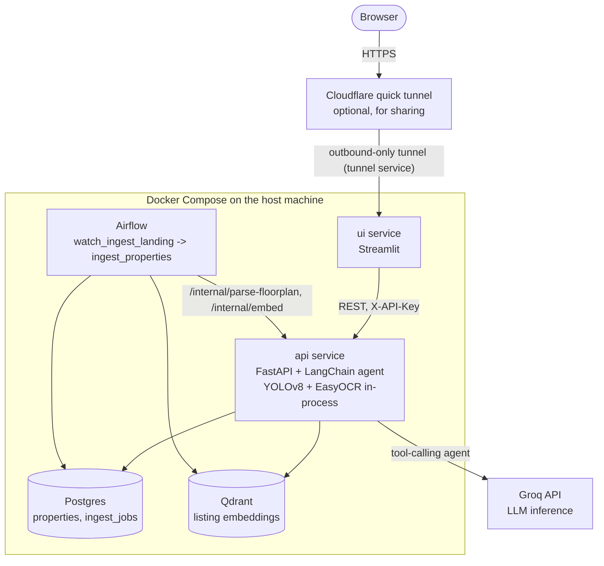

# SmartSense — AI-Powered Real Estate Search

A backend that ingests property listings (spreadsheet + floorplan images + PDF
certificates), automatically counts rooms from the floorplans using a
custom-trained computer vision model, indexes everything into both a
relational and a vector database, and answers natural-language questions
about the resulting portfolio through a multi-agent chatbot.

- **Floorplan understanding**: a YOLOv8 model (trained from scratch) detects
  room-name labels on a floorplan image; EasyOCR reads each one and a
  classifier buckets it into rooms / halls / kitchens / bathrooms.
- **Dual-database ingestion**: structured fields go to PostgreSQL, a text
  embedding of the listing (description + location + certificate text) goes
  to Qdrant.
- **Airflow-orchestrated ingestion pipeline**: dropping a spreadsheet
  triggers an idempotent Extract → DQ-check → Transform → Load Airflow DAG,
  not a synchronous request handler — see [Ingestion Pipeline
  (Airflow)](#ingestion-pipeline-airflow) below.
- **Multi-agent chat**: a LangChain tool-calling agent routes each question
  to a SQL agent (structured queries), a RAG chain over Qdrant (semantic
  search), or a custom report generator.
- **FastAPI + Streamlit**, each its own container (`api` and `ui`) with an
  independent healthcheck.

Built with: Python 3.10 · FastAPI · Streamlit · PostgreSQL · Qdrant · Airflow
· YOLOv8 (Ultralytics) · EasyOCR · LangChain · Groq

---

## Demo

There's no always-on public deployment. The project ran on Google Cloud
Run at $0/month (Cloud Run + Neon Postgres + Qdrant Cloud free tiers —
architecture and cost breakdown in [DEPLOY.md](DEPLOY.md)) until the GCP
billing account closed. To try it, run the full stack locally — see
[How to Run](#how-to-run) — which also runs Airflow, so ingestion works
end to end.

To share a running local copy over the internet, start the optional
Cloudflare quick tunnel. It exposes only the Streamlit UI (not the API,
databases or Airflow), needs no account, and prints a temporary
`https://<random>.trycloudflare.com` URL that changes on every restart:

```bash
docker compose --profile public up -d tunnel
docker logs tunnel 2>&1 | grep trycloudflare
```


---

## Architecture



Two independent paths:

- **Serving**: browser → `ui` → `api` → Postgres + Qdrant for data, Groq
  for the chat agent's reasoning. When shared through the tunnel, only
  `ui` is reachable from the internet; everything else stays on the
  Compose network.
- **Ingestion**: Airflow orchestrates Extract → DQ →
  Transform → Load, calling back into `api`'s `/internal/*` endpoints for
  the CV inference and embeddings it doesn't run itself — see [Ingestion
  Pipeline (Airflow)](#ingestion-pipeline-airflow).

---

## How to Run

Everything runs in Docker, so the steps are the same on Windows, macOS and
Linux. Plan for about 45–60 minutes the first time, most of it waiting for
the first build.

### 1. Prerequisites

- **[Docker Desktop](https://www.docker.com/products/docker-desktop/)**
  (or Docker Engine + the Compose plugin on Linux). Give it at least
  **8GB of memory** (Docker Desktop → Settings → Resources) and keep about
  **20GB of disk** free — the `api` image alone is ~10GB.
- **Git**
- **A [Groq](https://console.groq.com/keys) API key** — free; the chatbot
  uses it for its LLM calls.
- **Python 3** — only to generate the keys in step 2 (no packages needed).

### 2. Clone and configure

```bash
git clone https://github.com/AntiVicious/SmartSense-project.git
cd SmartSense-project
cp .env.example .env
```

(On Windows PowerShell, use `copy .env.example .env`.)

Open `.env` and replace the four `YOUR_..._HERE` placeholders. Everything
else can stay as it is for local use.

| Variable | What to put there |
|---|---|
| `GROQ_API_KEY` | Your Groq key (`gsk_...`) |
| `INTERNAL_API_KEY` | Any long random string — run the command below |
| `API_KEY` | A *different* long random string — run it again |
| `AIRFLOW_FERNET_KEY` | Output of the Fernet command below |

```bash
# random string for INTERNAL_API_KEY / API_KEY (run twice)
python -c "import secrets; print(secrets.token_hex(32))"

# AIRFLOW_FERNET_KEY
python -c "import base64, os; print(base64.urlsafe_b64encode(os.urandom(32)).decode())"
```

(Use `python3` instead of `python` if that's what your system has.)

### 3. Build and start

```bash
docker compose up -d --build
```

The first build takes 30–45 minutes (PyTorch, Ultralytics, EasyOCR, …).
After that, starting takes about a minute, and rebuilding after a code
change takes 1–2 minutes because the heavy dependency layer is cached.

Check that everything came up:

```bash
docker compose ps
```

Wait until `api` and `ui` show `(healthy)` — the API loads YOLOv8, EasyOCR
and the embedding model at startup, so it needs about a minute.
`airflow-init` showing `Exited (0)` is normal: it's a one-off setup step.

### 4. Load the sample data

A fresh install starts with empty databases. The repo ships a sample
dataset — 73 listings in `data/Property_list.xlsx`, with their floorplans in
`data/images/` and certificates in `data/certificates/`. Queue it for
ingestion:

```bash
docker compose exec api python scripts/backfill_ingest.py data/
```

Airflow picks the file up within a minute and runs the pipeline (floorplan
parsing, embeddings, loading Postgres and Qdrant). That takes a few minutes
on CPU. You can watch it in the Airflow UI (see below) under the
`ingest_properties` DAG. Once its run turns green, ask the chatbot
something like *"How many listings have 3 bedrooms?"*

Instead of the command, you can also upload `data/Property_list.xlsx`
through **Data Ingestion → Start Ingestion** in the UI — it goes through
the exact same pipeline.

### 5. Open it

- **UI:** http://localhost:8501
- **API docs:** http://localhost:8000/docs
- **Health check:** http://localhost:8000/health
- **Airflow UI:** http://localhost:8080 (log in with `AIRFLOW_ADMIN_USER` /
  `AIRFLOW_ADMIN_PASSWORD` from `.env` — `admin` / `admin` by default)

### 6. Stop it

```bash
docker compose down
```

Your data is kept in Docker volumes, so the next `docker compose up -d`
starts where you left off (no rebuild, no re-ingestion). To wipe the
databases and start from scratch, use `docker compose down -v` instead.

### Using your own data

Put your spreadsheet (Excel or CSV) in `data/`, its floorplan images in
`data/images/` (referenced by the `image_file` column) and certificate PDFs
in `data/certificates/` (referenced by the `certificates` column), then
ingest it the same way as step 4. Re-ingesting a file updates rows in place
rather than duplicating them. The floorplan model weights (`best_1000.pt`)
are downloaded automatically during the build — see
[Model weights](#model-weights).

### Troubleshooting

- **`api` keeps restarting or is never healthy:** check
  `docker compose logs api`. A `ValidationError` about a missing field means
  a `.env` value is still unset; getting killed (exit code 137) means
  Docker needs more memory.
- **"port is already allocated":** something else is using 8000, 8501 or
  8080. Stop it, or change the left-hand port under that service's `ports:`
  in `docker-compose.yml`.
- **Ingestion never finishes:** check the `watch_ingest_landing` and
  `ingest_properties` runs in the Airflow UI; a failed task's log says why.
- **Chat answers with an error:** check that `GROQ_API_KEY` is valid, then
  `docker compose up -d` again so the API picks up the change.

### How the images are split

`api` and `ui` are separate images (`src/Dockerfile.api` /
`src/Dockerfile.ui`). `ui` only needs Streamlit + `requests` (~760MB built,
vs. `api`'s ~10GB), since it talks to `api` over HTTP and never imports
torch/langchain itself. The Airflow image is also separate and lighter (no
PyTorch/LangChain — see [Ingestion Pipeline](#ingestion-pipeline-airflow)
below). Python dependencies are pinned to exact versions through
`constraints-api.txt` / `constraints-ui.txt`, so a fresh build gets the same
stack this was tested with.

---

## API

| Endpoint | Method | Purpose |
|---|---|---|
| `/` | GET | Trivial liveness ping |
| `/health` | GET | Checks Postgres, Qdrant, and agent initialization; 503 if any fail |
| `/chat` | POST | `{"query": str, "history": [[user, assistant], ...]}` → agent response |
| `/ingest` | POST | **Requires `X-API-Key`.** Upload an Excel/CSV file (max 15MB, spreadsheet content-types only); lands it and enqueues an Airflow ingestion run — see below |
| `/ingest/{job_id}` | GET | Poll the status of a submitted ingestion job (`queued` / `running` / `succeeded` / `failed`) |
| `/parse-floorplan-debug` | POST | **Requires `X-API-Key`.** Upload a single floorplan image (max 15MB, `image/*` only), get back the room-count JSON |
| `/internal/parse-floorplan`, `/internal/embed` | POST | Called by the Airflow DAG only (`X-Internal-Api-Key`, a separate secret from `X-API-Key`); not for external use |

---

## Project Structure

```
SmartSense-project/
├── src/
│   ├── api.py                # FastAPI app: routes + lifespan wiring only
│   ├── config.py             # pydantic-settings Settings (fails loudly on missing env vars)
│   ├── logging_config.py      # structured (JSON) logging setup -- Cloud Logging severity support
│   ├── db.py                  # lazy engine/Qdrant-client/embedder factories
│   ├── models.py              # SQLAlchemy Property + IngestJob models, request schemas
│   ├── floorplan.py           # YOLO + EasyOCR floorplan parsing, room classification
│   ├── documents.py           # PDF text extraction
│   ├── agents.py              # LangChain tool definitions + agent assembly
│   ├── ingest_landing.py      # POST /ingest's file-landing + ingest_jobs row creation
│   ├── ingest_support.py      # external_id / Qdrant point-id derivation (shared with Airflow)
│   ├── data_quality.py        # pandas DQ checks (shared with Airflow)
│   ├── main.py                # Streamlit UI (talks to api over HTTP only)
│   ├── Dockerfile.api         # FastAPI image -- fetches best_1000.pt at build time
│   └── Dockerfile.ui          # Streamlit image -- lean, no heavy deps
│
├── dags/                      # Airflow DAGs -- see Ingestion Pipeline below
│   ├── support.py             # Connections-based Postgres/Qdrant/internal-API helpers
│   ├── watch_ingest_landing_dag.py   # poller: claims landed files, triggers the pipeline
│   └── ingest_properties_dag.py      # Extract -> DQ -> Transform -> Load -> verify
├── airflow/Dockerfile         # lean Airflow image (no torch/langchain)
├── requirements-airflow.txt
├── scripts/backfill_ingest.py # re-lands a directory of historical spreadsheets
├── migrations/                # Alembic migrations
├── alembic.ini
│
├── tests/                    # pytest-discoverable; see Development below
├── notebooks/
│   └── train.ipynb           # YOLO training notebook (not part of the runtime image)
├── data/
│   ├── Property_list.xlsx
│   ├── images/
│   └── certificates/
│
├── .github/workflows/ci.yml  # lint + test on push to main
├── docker-compose.yml
├── DEPLOY.md                  # Cloud Run deployment steps + cost estimate
├── requirements.txt           # api's light deps (fastapi, langchain, ...)
├── requirements-heavy.txt     # api's heavy deps (torch, ultralytics, easyocr, ...)
├── requirements-ui.txt        # ui's only deps: streamlit, requests
└── requirements-dev.txt       # black, flake8, pytest
```

---

## Design Notes

**One process per container.** Early on, `run.sh` backgrounded uvicorn and
ran Streamlit in the foreground of one container, so a dead backend didn't
stop the container from looking "up" — Streamlit was still alive. `api`
and `ui` are now separate Compose services (`src/Dockerfile.api` /
`src/Dockerfile.ui`), each with its own healthcheck; `ui` talks to `api`
over the Compose network via `API_BASE_URL` (defaults to `http://api:8000`)
instead of `localhost`.

**Startup ordering.** The `app` container previously raced `postgres-db` and
crashed with `Connection refused`. Fixed with a Postgres healthcheck plus a
`depends_on: condition: service_healthy` in `docker-compose.yml`, and by
moving all database-dependent construction (engine, Qdrant client, agent
assembly) into FastAPI's `lifespan`, which only runs once the container
network is up.

**Lazy construction for testability.** `config.py`, `db.py`, and friends
build nothing at import time — the engine, Qdrant client, and embedding
model are constructed once in `lifespan` and handed to routes via FastAPI
`Depends`. This is what makes `import src.api` (and the test suite) work
without a network connection, a model download, or a live database.

**Build layering.** `requirements-heavy.txt` (PyTorch, Ultralytics, EasyOCR —
the ~30 minute part) is installed in its own Docker layer, separate from
`requirements.txt` and the application code. Changing `api.py` or a light
dependency triggers a 1–2 minute rebuild, not a 30-minute one.

---

## Hardening

Fixes made specifically to get this to a state worth deploying publicly:

**Structured logging, not `print()`.** Every module logs through
`logging.getLogger(__name__)`; `src/logging_config.py` installs a handler
that emits one JSON line per record with a `severity` key — Cloud Logging's
convention for inferring log level from stdout/stderr, which it can't do
from bare text. `LOG_LEVEL` (`Settings`, default `INFO`) controls the
threshold everywhere, including `httpx`/`httpcore`/`urllib3`, which are
capped at `WARNING` regardless (otherwise their per-request chatter drowns
out everything else at `DEBUG`). LangChain's `verbose=True` on the SQL
agent and `AgentExecutor` — previously unconditional, so every request
dumped its full reasoning trace to stdout — is now tied to the same knob
(`LOG_LEVEL=DEBUG`), off by default.

**No raw exception text over HTTP.** `/chat`'s error handler used to return
`f"Agent Error: {e}"` directly to the client — a real leak vector (stack
frames, connection strings, prompt content). It now logs the real
exception server-side against a correlation ID and returns only
`"Internal error. Reference ID: <id>"`; grep the id in `api`'s logs to find
what actually happened.

**Upload validation.** Both `POST /ingest` and `POST /parse-floorplan-debug`
used to call `await file.read()` with no limit — one large upload could
OOM the container. Both now check content-type first (spreadsheet
MIME-types for `/ingest`, `image/*` for `/parse-floorplan-debug`, `400` if
not), then read at most `MAX_UPLOAD_SIZE_MB` (`Settings`, default 15) + 1
bytes — enough to detect an oversized upload (`413`) without ever
buffering more than that in memory, regardless of what `Content-Length`
claims or omits.

**API key on the write/debug endpoints.** `POST /ingest` was an
unauthenticated public write path into the database; `POST
/parse-floorplan-debug` was free, unauthenticated compute (real YOLO +
EasyOCR inference) — a direct cost-abuse vector once this is billed
per-request on Cloud Run. Both now require `X-API-Key` matching
`Settings.API_KEY`, checked before either endpoint does any work. The `ui`
service holds this key server-side and attaches it on the user's behalf
(see `src/main.py`) — it's never sent to the end user's browser.
`/chat` and the rest of the UI stay open: the point of the public demo is
that people can actually use it without credentials; only the paths that
write to the database or run free-standing inference are gated. `/internal/*`
keeps its own, separate `X-Internal-Api-Key` (Airflow only).

**Database ports not published to the host.** `postgres-db` and
`qdrant-db` used `ports:` (bound to the host on every interface) with
`restart: always` and the credentials from `.env.example`. Both now use
`expose:` instead — reachable from other containers on the Compose
network, not from the host or (once deployed) the internet. `docker exec
postgres-db psql ...` still works for local debugging; a client on your
host connecting to `localhost:5432` no longer does.

---

## Ingestion Pipeline (Airflow)

`POST /ingest` used to run the whole Excel → Postgres/Qdrant pipeline
synchronously inside the request handler. It now just validates and lands
the file and returns `202` with a `job_id` — the actual work happens in an
Airflow DAG, and `GET /ingest/{job_id}` polls status from the app's own
`ingest_jobs` table (never Airflow's API — the two systems don't talk to
each other in that direction at all).

**Trigger: file landing, not a schedule.** `watch_ingest_landing` is a
1-minute-schedule poller DAG that dynamically maps over whatever's sitting
in `data/_incoming/`, atomically claims each file (`os.rename` into
`_incoming/_claimed/` — rename is atomic on the same filesystem, so two
overlapping runs can't double-claim one file), and calls `trigger_dag()` to
kick off `ingest_properties` with `{"spreadsheet_path": ..., "job_id": ...}`
in its `conf`. `scripts/backfill_ingest.py` and `POST /ingest` both land
files the exact same way, so a backfill run and a live upload go through
identical code from that point on.

**Task boundaries** (`dags/ingest_properties_dag.py`):

| Task | Does |
|---|---|
| `extract_spreadsheet` | Reads the Excel/CSV, writes it to a per-job Parquet staging file |
| `validate_data_quality` | Row count, missing required columns, null-rate-per-column, all-null `image_file` — hard-fails the DAG (`AirflowFailException`) past a threshold, see below |
| `extract_certificate_text` | Reads the referenced certificate PDFs (PyMuPDF) |
| `parse_floorplans` | Calls the app's `POST /internal/parse-floorplan` per referenced image — this image carries no torch, so floorplan parsing runs in the app container, not here |
| `compute_embeddings` | Calls `POST /internal/embed` for each listing's text |
| `load_qdrant` | Upserts vectors, keyed by a deterministic point ID — runs **before** Postgres, see below |
| `load_postgres` | Upserts rows, keyed by `external_id`, via `INSERT ... ON CONFLICT DO UPDATE` |
| `verify_load` | Re-reads both stores and hard-fails the DAG if any staged `external_id` is missing from either one |

No DataFrames cross a task boundary through XCom — each task writes Parquet
to a per-job staging path and only that path (plus small scalars) goes
through XCom.

**Idempotency.** Every row gets a stable `external_id` — the spreadsheet's
own `listing_id` if present, otherwise a SHA-256 hash of
title/location/image_file (`src/ingest_support.compute_external_id`, shared
by the app and the DAG so both compute the same value). Postgres writes are
`ON CONFLICT (external_id) DO UPDATE`, never a blind insert against the
autoincrement `id`; Qdrant point IDs are `uuid5`-derived from the same
`external_id`, never from the Postgres row's `id`. Re-running the DAG on the
same file — including via backfill — updates existing rows in place instead
of duplicating them.

**Dual-write ordering.** The old synchronous endpoint committed to Postgres
before upserting to Qdrant, so a failed Qdrant call could leave rows with no
vector. `load_qdrant` now runs first; if it fails and exhausts its retries,
`load_postgres` never runs for that batch — no Postgres row is written
without a corresponding vector. `verify_load` is the hard backstop
regardless: it checks that every staged `external_id` is actually present
in *both* stores by identity, not just that row counts match, and fails the
DAG if not.

**Retries.** Task-level retries with exponential backoff are the default
(`retries=3`, 2 min → 15 min max) except `validate_data_quality`
(`retries=0` — a data-quality failure isn't fixed by retrying).

**Data-quality thresholds** are Airflow Variables, not hardcoded:
`ingest_dq_min_rows` (default `1`) and `ingest_dq_null_rate_threshold`
(default `0.2`) — set them in the Airflow UI under Admin → Variables.

**Backfill.**

```bash
docker compose run --rm api python scripts/backfill_ingest.py data/backfill/
```

Lands every spreadsheet in the given directory exactly the way `POST
/ingest` does (a real `ingest_jobs` row per file), then lets
`watch_ingest_landing` pick each one up on its next 1-minute cycle. Safe to
re-run — idempotency is by row content, not upload time.

**Airflow's metadata DB is a separate Postgres instance** (`airflow-postgres`
in `docker-compose.yml`), not a second logical database in the app's own
`postgres-db` — Airflow's own migrations and restarts shouldn't touch
application data or vice versa.

**Airflow Connections, not env vars, inside DAG code.** `dags/support.py`
reads Postgres/Qdrant/internal-API config via
`BaseHook.get_connection(...)`; the connections themselves are seeded from
`AIRFLOW_CONN_*` environment variables on the Airflow containers in
`docker-compose.yml` — that's Airflow's own documented mechanism for
container-based Connection seeding, not a `os.environ` read from within a
DAG.

---

## Floorplan CV Model

The case study's annotations (`annotations.coco.json`) didn't label room
types directly — they were bounding boxes for text elements (`room_name`,
`room_dim`) on the floorplan image. That shaped a 2-stage pipeline:

1. **Detection**: a `YOLOv8s` model, trained from scratch (via its `.yaml`
   architecture, using `ultralytics`) on an 80/20 train/val split, finds the
   `room_name` text boxes.
2. **Recognition**: each detected box is cropped and passed to EasyOCR,
   which reads the text (e.g. "KITCHEN", "BATH"). A substring-based
   classifier then buckets the text into `rooms` / `halls` / `kitchens` /
   `bathrooms` — see `src/floorplan.py:classify_room_label` and
   `tests/test_floorplan_classification.py` for its exact (imperfect)
   rules and known false positives.

**Metrics.** Two different things are worth measuring here, and they're not
the same number:

- **Detection quality (mAP@.5)**: how well YOLO finds the `room_name` boxes.
  The trained model reached **99.3%** mAP@.5 on the validation split.
- **End-to-end room-count accuracy**: whether the full YOLO+OCR+classifier
  pipeline gets the actual room counts right — a mAP score doesn't capture
  OCR or classification errors downstream of detection. Measured against
  hand-labeled ground truth over **all 73 images in `data/images/`**
  (N=1220 detected boxes; full methodology and confusion matrices in
  `eval/REPORT.md`). The headline number is **OCR recall, not
  classification accuracy**: the fraction of detected boxes where EasyOCR
  returned *no* text at all (which `classify_room_label` can only ever
  bucket as `others`, regardless of what the text actually said) fell
  from **410/1220 (33.6%) to 131/1220 (10.7%)** after padding and
  upscaling each crop before OCR (`prepare_ocr_crop`, `src/floorplan.py`).
  Overall accuracy moved from 943/1190 to 969/1190 (0.79 → 0.81, N=1190
  scored boxes) — a real, statistically significant improvement (paired
  test, p=0.003), but a secondary number: `classify_room_label`'s
  substring rules (documented, known-imperfect — see
  `tests/test_floorplan_classification.py`) are still unfixed, and
  `eval/REPORT.md` found the larger sample surfaces more of their bugs,
  not fewer, once OCR stops hiding them.

The training run originally produced two checkpoints (300 and 1000 epochs).
Both were benchmarked on room_name detection *count* — |predicted count -
hand-counted true count| per image, not an OCR/classification metric —
against N=16 hand-labeled images (of 73 total; script and full
methodology in `scripts/benchmark_yolo_checkpoints.py`,
`eval/yolo_checkpoint_benchmark.md`). Out of 16: **the 1000-epoch model
won 7, the 300-epoch model won 2, and 7 tied** — a 7:2 edge among the 9
decided comparisons, not a 7/16 minority as it reads without the tie
count spelled out. Mean absolute error was 2.75/image (1000-epoch) vs.
3.38/image (300-epoch), ~19% lower. The 300-epoch checkpoint was deleted
on that basis; re-deriving the comparison from the original raw
detections reproduced the same numbers exactly, so the decision holds.

`notebooks/train.ipynb` has the full training/preprocessing code (COCO ->
YOLO format conversion, the train/val split, the training call).

---

## Development & Testing

```bash
pip install -r requirements.txt -r requirements-heavy.txt -r requirements-dev.txt

black --line-length 110 --check .
flake8 .

for f in tests/test_*.py; do python "$f"; done
# or, equivalently: pytest tests/
```

`black`/`flake8` run over the whole repo, including `dags/` and `scripts/`
— static analysis only, so it doesn't matter that `apache-airflow` isn't
in `requirements-dev.txt`. Actually *running* the DAGs (or `airflow dags
test`) does need the Airflow image (`airflow/Dockerfile`).

Tests use hand-written fakes and dependency injection (in-memory SQLite,
fake Qdrant client/embedder, `TestClient` with `app.dependency_overrides`)
rather than a live Postgres/Qdrant/LLM — see `tests/` for the pattern.
`tests/test_data_quality.py` and `tests/test_ingest_support.py` exercise
the pure logic shared with the Airflow DAGs the same way, no Airflow
needed. CI (`.github/workflows/ci.yml`) runs both lint and the full test
suite on every push to `main`.

**Database migrations** are managed with Alembic:

```bash
alembic upgrade head
```

Run this once against a fresh `postgres-db` (or after pulling a change that
adds a migration) — `docker compose up` does not run it automatically.

---

## Model weights

`best_1000.pt` (~67MB) isn't committed to git. It's published as a
[GitHub release asset](https://github.com/AntiVicious/SmartSense-project/releases/tag/model-weights-v1),
and `src/Dockerfile.api` downloads it at build time (pinned to that
release tag and a SHA256 checksum, so a build never silently picks up a
different file).

- **Building with Docker**: nothing to do — `docker compose up --build`
  fetches it automatically.
- **Running outside Docker** (e.g. `notebooks/train.ipynb`, or calling
  `src/floorplan.py` directly): download it yourself and place it at
  `src/best_1000.pt`:
  ```bash
  curl -L -o src/best_1000.pt \
    https://github.com/AntiVicious/SmartSense-project/releases/download/model-weights-v1/best_1000.pt
  ```
- **Publishing a retrained model**: create a new release tag, upload the
  new `.pt` file as its asset, and update `MODEL_WEIGHTS_URL`/
  `MODEL_WEIGHTS_SHA256` in `src/Dockerfile` to match.
