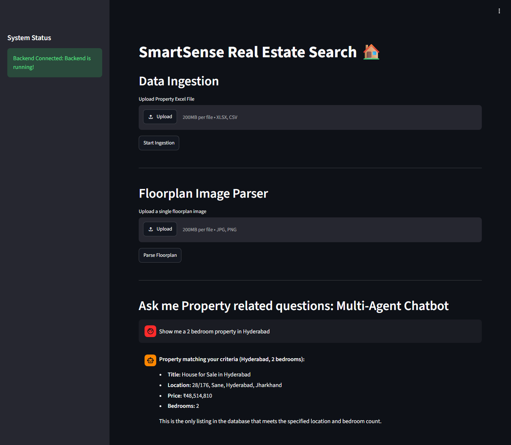

# SmartSense — AI-Powered Real Estate Search

SmartSense ingests property listings (a spreadsheet, floorplan images and PDF
certificates), counts rooms from each floorplan with a custom-trained
computer vision model, stores the results in a relational and a vector
database, and answers natural-language questions about the listings through
a multi-agent chatbot.

- **Floorplan parsing**: a YOLOv8 model trained from scratch detects
  room-name labels on a floorplan; EasyOCR reads each label and a rule-based
  classifier sorts it into rooms, halls, kitchens or bathrooms.
- **Two stores**: structured fields go to PostgreSQL; an embedding of each
  listing's description, location and certificate text goes to Qdrant.
- **Airflow ingestion**: uploading a spreadsheet queues an idempotent
  extract → data-quality check → transform → load DAG instead of doing the
  work inside the HTTP request.
- **Multi-agent chat**: a LangChain tool-calling agent sends each question to
  a text-to-SQL agent, a RAG chain over Qdrant, or a report generator.
- **FastAPI + Streamlit** run as separate containers, each with its own
  healthcheck.

Built with Python 3.10, FastAPI, Streamlit, PostgreSQL, Qdrant, Airflow,
YOLOv8 (Ultralytics), EasyOCR, LangChain and Groq.



---

## Demo

There is no always-on public deployment. The project previously ran on
Google Cloud Run for $0/month using free tiers (Cloud Run, Neon Postgres,
Qdrant Cloud); [DEPLOY.md](DEPLOY.md) describes that setup. To try it, run
the full stack locally as described in [How to Run](#how-to-run).

To share a local copy, start the optional Cloudflare quick tunnel. It
exposes only the Streamlit UI, needs no account, and prints a temporary
`https://<random>.trycloudflare.com` URL that changes on every restart:

```bash
docker compose --profile public up -d tunnel
docker logs tunnel 2>&1 | grep trycloudflare
```

---

## Architecture


- **Serving**: browser → `ui` → `api` → Postgres and Qdrant, with Groq
  providing the LLM for the chat agent. Through the tunnel, only `ui` is
  reachable from the internet.
- **Ingestion**: Airflow runs the pipeline and calls `api`'s `/internal/*`
  endpoints for floorplan inference and embeddings, so the Airflow image
  doesn't need PyTorch.

---

## How to Run

Everything runs in Docker, so the steps are the same on Windows, macOS and
Linux. Allow 45–60 minutes the first time, mostly for the first build.

### 1. Prerequisites

- **[Docker Desktop](https://www.docker.com/products/docker-desktop/)**
  (or Docker Engine with the Compose plugin on Linux), with at least
  **8 GB of memory** (Settings → Resources) and about **20 GB of free disk**.
  The `api` image alone is about 10 GB.
- **Git**
- **A [Groq](https://console.groq.com/keys) API key** (free), used by the
  chatbot.
- **Python 3**, only to generate the keys in step 2.

### 2. Clone and configure

```bash
git clone https://github.com/AntiVicious/SmartSense-project.git
cd SmartSense-project
cp .env.example .env
```

(On Windows PowerShell, use `copy .env.example .env`.)

Open `.env` and replace the four `YOUR_..._HERE` placeholders. The other
values work as they are for local use.

| Variable | Value |
|---|---|
| `GROQ_API_KEY` | Your Groq key (`gsk_...`) |
| `INTERNAL_API_KEY` | A long random string (command below) |
| `API_KEY` | A different long random string |
| `AIRFLOW_FERNET_KEY` | Output of the Fernet command below |

```bash
# random string for INTERNAL_API_KEY / API_KEY (run twice)
python -c "import secrets; print(secrets.token_hex(32))"

# AIRFLOW_FERNET_KEY
python -c "import base64, os; print(base64.urlsafe_b64encode(os.urandom(32)).decode())"
```

### 3. Build and start

```bash
docker compose up -d --build
```

The first build takes 30–45 minutes (PyTorch, Ultralytics, EasyOCR). After
that, startup takes about a minute, and a rebuild after a code change takes
1–2 minutes because the heavy dependencies are in a cached layer.

```bash
docker compose ps
```

Wait until `api` and `ui` show `(healthy)`; the API loads its models at
startup. `airflow-init` showing `Exited (0)` is expected, since it is a
one-off setup step.

### 4. Load the sample data

The repo includes 73 sample listings in `data/Property_list.xlsx`, with
floorplans in `data/images/` and certificates in `data/certificates/`.
Queue them for ingestion:

```bash
docker compose exec api python scripts/backfill_ingest.py data/
```

Airflow picks the file up within a minute. The run takes about 15 minutes on
CPU, mostly floorplan parsing. You can follow it in the Airflow UI under the
`ingest_properties` DAG. When the run finishes, ask the chatbot something
like *"How many listings have 3 bedrooms?"*

You can also upload `data/Property_list.xlsx` through **Data Ingestion →
Start Ingestion** in the UI; it goes through the same pipeline.

### 5. Open it

- **UI:** http://localhost:8501
- **API docs:** http://localhost:8000/docs
- **Health check:** http://localhost:8000/health
- **Airflow UI:** http://localhost:8080 (`AIRFLOW_ADMIN_USER` /
  `AIRFLOW_ADMIN_PASSWORD` from `.env`, `admin` / `admin` by default)

### 6. Stop it

```bash
docker compose down
```

Data is kept in Docker volumes, so the next `docker compose up -d` resumes
where you left off. `docker compose down -v` deletes the databases.

### Using your own data

Put a spreadsheet (Excel or CSV) in `data/`, its floorplans in
`data/images/` (named in the `image_file` column) and certificate PDFs in
`data/certificates/` (named in the `certificates` column), then ingest it as
in step 4. Re-ingesting a file updates existing rows instead of duplicating
them.

### Troubleshooting

- **`api` keeps restarting:** run `docker compose logs api`. A
  `ValidationError` about a missing field means a `.env` value is unset;
  exit code 137 means Docker needs more memory.
- **"port is already allocated":** another program is using port 8000, 8501
  or 8080. Stop it or change the host port in `docker-compose.yml`.
- **Ingestion never finishes:** check the `watch_ingest_landing` and
  `ingest_properties` runs in the Airflow UI; the failed task's log shows
  the cause.
- **Chat returns an error:** check `GROQ_API_KEY`, then run
  `docker compose up -d` again.

---

## API

| Endpoint | Method | Purpose |
|---|---|---|
| `/` | GET | Liveness ping |
| `/health` | GET | Checks Postgres, Qdrant and the agent; 503 if any fail |
| `/chat` | POST | `{"query": str, "history": [[user, assistant], ...]}` → agent response |
| `/ingest` | POST | **Requires `X-API-Key`.** Upload an Excel/CSV file (max 15 MB); queues an ingestion job |
| `/ingest/{job_id}` | GET | Job status: `queued` / `running` / `succeeded` / `failed` |
| `/parse-floorplan-debug` | POST | **Requires `X-API-Key`.** Upload one floorplan image (max 15 MB), get its room counts |
| `/internal/parse-floorplan`, `/internal/embed` | POST | Used by Airflow only, with a separate `X-Internal-Api-Key` |

---

## Project Structure

```
SmartSense-project/
├── src/
│   ├── api.py               # FastAPI routes and startup wiring
│   ├── config.py            # pydantic-settings configuration
│   ├── logging_config.py    # JSON logging
│   ├── db.py                # engine, Qdrant client and embedder factories
│   ├── models.py            # SQLAlchemy models and request schemas
│   ├── floorplan.py         # YOLO + EasyOCR parsing and room classification
│   ├── documents.py         # PDF text extraction
│   ├── agents.py            # LangChain tools and agent
│   ├── ingest_landing.py    # file landing and ingest_jobs rows for POST /ingest
│   ├── ingest_support.py    # stable IDs shared with Airflow
│   ├── data_quality.py      # data-quality checks shared with Airflow
│   ├── main.py              # Streamlit UI
│   ├── Dockerfile.api
│   └── Dockerfile.ui
├── dags/
│   ├── support.py                   # Airflow connection helpers
│   ├── watch_ingest_landing_dag.py  # claims landed files, triggers the pipeline
│   └── ingest_properties_dag.py     # extract → DQ → transform → load → verify
├── airflow/Dockerfile       # Airflow image (no torch or langchain)
├── migrations/              # Alembic migrations
├── scripts/                 # backfill and evaluation scripts
├── eval/                    # floorplan evaluation data and report
├── tests/
├── notebooks/train.ipynb    # YOLO training
├── data/                    # sample listings, floorplans, certificates
├── docker-compose.yml
└── DEPLOY.md                # former Cloud Run deployment
```

---

## Design Notes

**One process per container.** `api` and `ui` are separate Compose services
with their own healthchecks, so a crashed backend shows up as an unhealthy
container. `ui` reaches `api` over the Compose network through
`API_BASE_URL`.

**Startup order.** Postgres has a healthcheck and `api` waits for it with
`depends_on: condition: service_healthy`. Database clients and the agent are
built in FastAPI's `lifespan`, not at import time.

**Testable without services.** Nothing connects to a database or loads a
model at import time; routes receive their dependencies through FastAPI
`Depends`. The tests replace them with in-memory SQLite, fake Qdrant and
embedder objects, and `TestClient` dependency overrides.

**Build caching.** PyTorch, Ultralytics and EasyOCR are installed in their
own Docker layer, so changing application code or a light dependency
rebuilds in 1–2 minutes. Exact versions are pinned with
`constraints-api.txt` and `constraints-ui.txt`.

### Security

- **Structured logging.** All modules log JSON lines with a `severity` field
  (understood by Cloud Logging). `LOG_LEVEL` controls verbosity, including
  LangChain's agent traces, which only appear at `DEBUG`.
- **No exception text in responses.** `/chat` logs errors server-side with a
  correlation ID and returns only `Internal error. Reference ID: <id>`.
- **Upload limits.** Upload endpoints check the content type, then read at
  most `MAX_UPLOAD_SIZE_MB` + 1 bytes, returning `400` or `413` without
  buffering oversized files.
- **API keys on write and inference endpoints.** `/ingest` and
  `/parse-floorplan-debug` require `X-API-Key`. The `ui` service adds the key
  server-side, so it never reaches the browser. `/chat` stays open so the UI
  works without logging in.
- **Databases not exposed.** Postgres and Qdrant use `expose:` instead of
  `ports:`, so they are reachable only from other containers.

---

## Ingestion Pipeline (Airflow)

`POST /ingest` validates the file, saves it to `data/_incoming/`, creates an
`ingest_jobs` row and returns `202` with a `job_id`. `GET /ingest/{job_id}`
reads the job status from that table.

**Trigger.** `watch_ingest_landing` runs every minute, claims each landed
file by renaming it into `_incoming/_claimed/` (an atomic operation, so two
runs can't claim the same file), and triggers `ingest_properties` with the
file path and job ID. `scripts/backfill_ingest.py` lands files the same way.

**Tasks** (`dags/ingest_properties_dag.py`):

| Task | Does |
|---|---|
| `extract_spreadsheet` | Reads the Excel/CSV into a per-job Parquet staging file |
| `validate_data_quality` | Checks row count, required columns and null rates; fails the DAG past a threshold |
| `extract_certificate_text` | Extracts text from the referenced certificate PDFs |
| `parse_floorplans` | Calls `api`'s `/internal/parse-floorplan` for each image |
| `compute_embeddings` | Calls `/internal/embed` for each listing |
| `load_qdrant` | Upserts vectors under deterministic point IDs |
| `load_postgres` | Upserts rows with `INSERT ... ON CONFLICT (external_id) DO UPDATE` |
| `verify_load` | Fails the DAG if any staged listing is missing from either store |

Tasks pass Parquet file paths through XCom, not DataFrames.

**Idempotency.** Each row gets a stable `external_id`: the spreadsheet's
`listing_id` if present, otherwise a SHA-256 hash of title, location and
image file. Qdrant point IDs are `uuid5` values derived from the same ID, so
re-running a file updates rows in both stores instead of duplicating them.

**Write order.** Qdrant is loaded before Postgres, so a Qdrant failure never
leaves a Postgres row without a vector. `verify_load` then checks every
listing by ID in both stores.

**Retries.** Tasks retry 3 times with exponential backoff (2 to 15 minutes),
except `validate_data_quality`, which fails immediately.

**Thresholds** are Airflow Variables: `ingest_dq_min_rows` (default `1`) and
`ingest_dq_null_rate_threshold` (default `0.2`).

**Separate metadata database.** Airflow uses its own Postgres container
(`airflow-postgres`), and DAG code reads connections through
`BaseHook.get_connection()`, seeded from `AIRFLOW_CONN_*` variables in
`docker-compose.yml`.

---

## Floorplan Model

The dataset's annotations mark text boxes on each floorplan (`room_name`,
`room_dim`), not room types, so parsing has two stages:

1. **Detection**: a YOLOv8s model trained from scratch (80/20 train/val
   split) finds `room_name` boxes. It reaches **99.3% mAP@0.5** on the
   validation split.
2. **Recognition**: each box is cropped, padded and upscaled, read by
   EasyOCR, and classified by substring rules in
   `src/floorplan.py:classify_room_label`. The rules have known false
   positives, listed in `tests/test_floorplan_classification.py`.

**Evaluation** (all 73 images, 1,220 detected boxes, hand-labelled; details
in [eval/REPORT.md](eval/REPORT.md)):

- Padding and upscaling crops before OCR cut empty OCR results from
  **33.6% to 10.7%** of boxes. An empty result can only be classified as
  `others`, so this was the largest source of errors.
- Per-box room-type accuracy rose from **0.79 to 0.81** (1,190 scored boxes,
  paired sign test p = 0.003). The remaining errors come mostly from the
  substring rules.

Two training checkpoints (300 and 1000 epochs) were compared on room-label
count error over 16 hand-counted images: the 1000-epoch model had a mean
absolute error of 2.75 per image against 3.38, so it was kept
([eval/yolo_checkpoint_benchmark.md](eval/yolo_checkpoint_benchmark.md)).

`notebooks/train.ipynb` contains the data conversion, split and training
code.

---

## Development & Testing

```bash
pip install -r requirements.txt -r requirements-heavy.txt -r requirements-dev.txt

black --line-length 110 --check .
flake8 .
pytest tests/
```

Running the DAGs themselves requires the Airflow image (`airflow/Dockerfile`).
CI (`.github/workflows/ci.yml`) runs lint and tests on every push to `main`.

Database migrations use Alembic. Run them against a fresh database, or after
pulling a new migration:

```bash
alembic upgrade head
```

---

## Model Weights

`best_1000.pt` (about 67 MB) is published as a
[GitHub release asset](https://github.com/AntiVicious/SmartSense-project/releases/tag/model-weights-v1)
rather than committed. `src/Dockerfile.api` downloads it at build time and
checks its SHA-256 checksum.

To run outside Docker, download it to `src/best_1000.pt`:

```bash
curl -L -o src/best_1000.pt \
  https://github.com/AntiVicious/SmartSense-project/releases/download/model-weights-v1/best_1000.pt
```

To publish a retrained model, upload it to a new release and update
`MODEL_WEIGHTS_URL` and `MODEL_WEIGHTS_SHA256` in `src/Dockerfile.api`.
